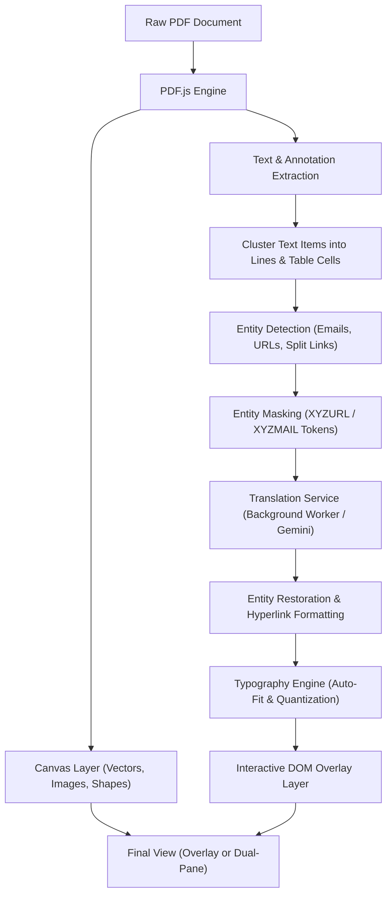

# 📄 PDF Translator - Browser Extension (Chrome & Firefox)

[](https://developer.chrome.com/docs/extensions/mv3/intro/)
[](https://opensource.org/licenses/MIT)
[](#-how-to-install)

A high-performance browser extension that translates foreign-language PDFs in real time while **preserving 100% of the original visual layout, vector graphics, diagrams, tables, and typography**. 

The translated document renders directly inside your browser with **zero file downloads, zero cloud uploads, and zero formatting loss**.

---

## ✨ Key Features

### 📐 Layout & Typography Preservation
- **Pixel-Accurate Coordinate Positioning**: Extracts text element transforms via Mozilla's [PDF.js](https://github.com/mozilla/pdf.js) and maps translated blocks precisely into the original bounding boxes.
- **Smart Auto-Fit Scaling**: Dynamically adjusts font sizes, line heights, and letter-spacing to prevent text overflow while maintaining typographic hierarchy.
- **Table Cell Boundary Protection**: Automatically identifies table columns, cell gutters, and mathematical symbols, preserving column alignments without clipping borders.
- **Canvas Vector Masking**: Replaces original foreign text cleanly while keeping all underlying graphics, shapes, logos, and vector illustrations intact.

### 🔗 Smart Hyperlink & Email Engine
- **Universal Email Recognition**: Dynamically detects and validates any email address from any domain (e.g. `@gmail.com`, `@uni-kl.de`, `@rptu.de`, `@company.org`) without hardcoded restrictions. Automatically renders them as interactive `mailto:` links.
- **Multi-Line Split Link Detection**: Detects hyphenated URLs and domain names broken across lines due to margin constraints (e.g., `www.minijob-` on line 1 and `zentrale.de` on line 2), linking both parts to the unified destination (`https://www.minijob-zentrale.de`).
- **Entity Translation Protection**: Masks all URLs, email IDs, and link fragments with inert tokens (`XYZURL0XYZ`, `XYZMAIL0XYZ`) before translating, preventing translation engines from translating domain words (e.g. preventing `zentrale.de` from becoming `central.de`) or inserting spaces into email addresses.
- **PDF Annotation Integration**: Ingests native document Link annotations (`page.getAnnotations()`) and binds them to overlay text blocks so author links open in a new tab.

### 👓 Multiple Viewing Experiences
- **Overlay Mode**: Translated text seamlessly integrated onto the original document with auto-fit font scaling.
- **Side-by-Side Dual Pane**: Synchronized split-view (Original PDF on the left, Translated PDF on the right) with locked scrolling.
- **Original Mode**: Instantly toggle back to the raw untranslated document with a single click.
- **Interactive Hover Lens**: Hover over any translated sentence in Overlay mode to inspect the original foreign text in a floating glassmorphic tooltip.

### 📷 Scanned PDF & AI Vision Translation
- **Automatic Scanned Document Detection**: Detects image-only PDFs with zero selectable digital text (e.g. scanned textbooks, paper forms, historical manuscripts).
- **Multimodal Gemini AI Vision**: Directly transcribes and translates complex non-Latin scripts (Chinese, Japanese, Arabic, Russian) and multi-column scanned tables with state-of-the-art vision models.
- **Quota-Gated Fallback System**: If a user consumes their 1,500 daily requests on Google AI Studio's free tier (HTTP 429), the app detects quota exhaustion and automatically unlocks alternative paths:
  1. **Free Cloud OCR + Google Translate**: Unlimited, zero API keys required, $0 cost.
  2. **Backup Gemini API Key**: Instantly paste a second free key from another Google account.
  3. **Full Document Pre-OCR**: One-click guidance to run large 100+ page books through PDF24 / Adobe free OCR.

### ⚡ Dual Translation Providers
- **Free Public Engine (Default)**: Ready out of the box with zero configuration or API keys required. Features rate-limit throttling and multi-line batching.
- **Google Gemini AI Engine (Optional)**: Connect your free API key from [Google AI Studio](https://aistudio.google.com) (`gemini-1.5-flash`) for nuanced, publication-grade academic and technical translations.


---

## 🏗️ Architecture & Pipeline



---

## 📁 Project Directory Structure

```text
Translation extension for pdf/
├── manifest.json              # Extension Manifest V3 configuration
├── background/
│   └── background.js          # Service worker (Context menus & CORS-free translation fetches)
├── services/
│   └── translator.js          # Translation client, caching, inert masking & entity protection
├── viewer/
│   ├── viewer.html            # Main reader application interface
│   ├── viewer.css             # Glassmorphism styling, responsive dual-pane & typography
│   └── viewer.js              # Core layout engine, clustering, auto-fitting & overlay logic
├── popup/
│   ├── popup.html             # Toolbar action popup
│   ├── popup.css              # Popup styling
│   └── popup.js               # Quick-action handlers (Translate Tab / Open Viewer)
├── lib/
│   ├── pdf.min.js             # Mozilla PDF.js core library
│   └── pdf.worker.min.js      # PDF.js background rendering worker
├── icons/                     # Extension branding icons (16px, 48px, 128px)
├── tests/                     # Verification test scripts & entity parsers
├── sample_french_article.pdf  # Bundled sample document for instant testing
└── README.md                  # Project documentation
```

---

## 🚀 How to Install

### Google Chrome / Microsoft Edge / Brave / Opera

1. Open your browser and navigate to:
   - **Chrome**: `chrome://extensions`
   - **Edge**: `edge://extensions`
   - **Brave**: `brave://extensions`
2. Enable **Developer mode** (toggle in the top-right corner).
3. Click the **"Load unpacked"** button in the top-left corner.
4. Select this directory:
   ```text
   c:\Users\Keshav\Documents\Translation extension for pdf
   ```
5. Pin **PDF Translator** to your browser toolbar for quick access.

### Mozilla Firefox (Local Testing)

1. Open Firefox and navigate to: `about:debugging#/runtime/this-firefox`.
2. Click **"Load Temporary Add-on..."**.
3. Select the [manifest.json](file:///c:/Users/Keshav/Documents/Translation%20extension%20for%20pdf/manifest.json) file inside this directory.
4. The extension icon will appear in your Firefox toolbar.

---

## 📦 Packaging & Publishing to Web Stores

### Step 1: Generate Release Package (.zip)
Run this command from your terminal:
```bash
python package.py
```
This runs [`package.py`](file:///c:/Users/Keshav/Documents/Translation%20extension%20for%20pdf/package.py) to package all required runtime assets into `pdf-translator-extension.zip` (~412 KB) with strictly validated forward slashes (`/`), preventing the Firefox AMO *"Invalid file name in archive"* error caused by Windows backslashes.

### Step 2: Publish to Google Chrome Web Store
1. Go to the [Chrome Developer Dashboard](https://chrome.google.com/webstore/devconsole).
2. Sign in with your Google account (one-time $5 developer registration fee if new).
3. Click **"Add new item"**.
4. Drag & drop `pdf-translator-extension.zip`.
5. Fill in the store listing (Description, Category: *Productivity*, screenshots, privacy policy).
6. Under **Privacy practices**, state that permissions are for local document rendering and translation requests.
7. Click **"Submit for Review"** (typically approved within 24–48 hours).

### Step 3: Publish to Mozilla Firefox Add-ons (AMO)
1. Go to the [Firefox Add-on Developer Hub](https://addons.mozilla.org/developers/).
2. Log in or create a free Mozilla account ($0 fee).
3. Click **"Submit a New Add-on"**.
4. Choose distribution: **"On this site"** (public AMO listing) or **"On your own"** (self-distributed signed XPI).
5. Upload `pdf-translator-extension.zip`. The automated linter will validate the manifest and code.
6. Provide metadata, screenshots, and summary.
7. Click **"Submit"** (automated validation finishes within minutes; manual review takes 1–2 days).

---

## 🎯 How to Use

### Method 1: Translate Any PDF Open in Your Browser
1. Open any online PDF document URL in a browser tab.
2. Click the **PDF Translator** extension icon in your toolbar.
3. Click **"Translate Current PDF"** &rarr; The document opens immediately in the viewer with layout intact.

### Method 2: Open a Local PDF File
1. Click the **PDF Translator** toolbar icon and click **"Open PDF Translator Viewer"**.
2. Click **"Browse PDF File"** or simply drag & drop any PDF into the window.
3. Use the **"Load Sample French PDF"** button to test instant translation on a sample research paper.

### Method 3: Right-Click Context Menu
- Right-click any PDF link or open PDF page &rarr; Select **"🌐 Translate linked PDF with PDF Translator"**.

---

## ⚙️ Configuration & Settings

Click the **gear icon (⚙️)** in the viewer toolbar to open the settings modal:

| Setting | Options | Description |
| :--- | :--- | :--- |
| **Translation Engine** | `Free Google Translate` (Default) | Uses the background service worker. No API key or account needed. |
| **Gemini AI Provider** | `Google Gemini AI` | Enables `gemini-1.5-flash` for high-precision technical terminology. |
| **Gemini API Key** | `AIzaSy...` | Paste your free key from [Google AI Studio](https://aistudio.google.com). Stored securely in `chrome.storage.sync`. |
| **Target Language** | 50+ Languages | Select via toolbar dropdown (English, Spanish, German, French, Chinese, Japanese, etc.). |

---

## ⌨️ Shortcuts & Navigation

| Control | Action |
| :--- | :--- |
| **Zoom Dropdown / `+` / `-`** | Adjust scale (75%, 100%, 125%, 150%, 200%, Page Width, Page Fit). |
| **Page Input / Next / Prev** | Jump directly to any page number with smooth scrolling. |
| **View Mode Buttons** | Toggle between **Overlay**, **Side-by-Side**, and **Original** views. |
| **Re-translate Button** | Clears translation cache and re-translates the current document. |
| **Hyperlinks & Emails** | Click any blue underlined link to open target in a new tab without lens interference. |

---

## 🔒 Privacy & Security

- **Zero Cloud Storage**: All PDF parsing, rendering, and overlay layout calculations occur strictly within your browser's local memory.
- **No Third-Party Tracking**: No telemetry, tracking scripts, or analytics are collected.
- **Manifest V3 Compliant**: Uses explicit declarative permissions and secure background service workers.

---

## 📄 License

This project is licensed under the [MIT License](https://opensource.org/licenses/MIT).
